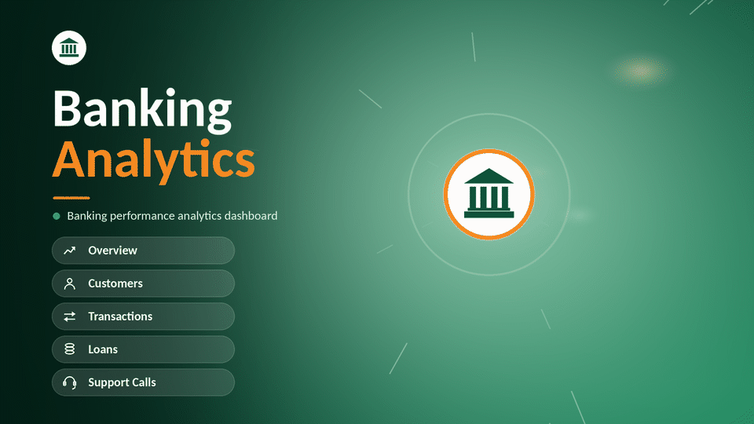

# Banking-Analytics-Dashboard
# 🏦 Banking Analytics Dashboard (Power BI)

An end-to-end Power BI project (A to Z): data cleaning in Power Query, data modelling, and a 6-page interactive dashboard analysing customers, accounts, transactions, loans and support calls for a retail bank. It uses a custom green & gold design with an animated home page. ✨

## 🖼️ Preview

| 📊 Overview | 👥 Customers |
|---|---|
|  |  |

| 💸 Transactions | 🏠 Loans |
|---|---|
|  |  |

| 🎧 Support Calls |
|---|
|  |

## ❓ Business Questions
- 👥 Who are our customers, and how many actually hold an account?
- 💸 How much money flows through the bank, and what is the net cash flow?
- 🏠 How is the loan portfolio distributed by type, amount and interest rate?
- 🎧 How well does support resolve customer issues?

## 🗂️ Dataset
| Table | Rows | Description |
|---|---|---|
| 👥 customers | 5,050 | Customer ID, name, state, join date |
| 💳 Accounts | 5,100 | Account type (Checking / Savings / Business) and balance |
| 💸 Transactions | 20,000 | Deposits, withdrawals, payments, transfers (May 2022 - May 2025) |
| 🏠 Loans | 2,600 | Loan type, amount, interest rate, start/end dates |
| 💳 Cards | 4,000 | Card type and expiry |
| 🎧 SupportCalls | 3,100 | Issue type and resolution status (May 2024 - May 2025) |
| 📅 Calender | - | Date table for time analysis |

## 📑 Dashboard Pages
| Page | What it shows |
|---|---|
| 🏠 Home | Animated landing page and navigation |
| 📊 Overview | Customers, accounts, total balance, transactions, balance by account type, loans by type |
| 👥 Customers | Account penetration (63.3%), new customers (L12M), customers by state and join year |
| 💸 Transactions | Total amount, count, average, net cash flow, breakdown by type and account type |
| 🏦 Loans | Portfolio size, active loans, weighted interest rate, amount by type, interest-rate bands |
| 🎧 Support Calls | Total calls, resolution rate, issue types, resolved vs unresolved |

## 🔍 Key Findings
- 👥 5,050 customers and 5,100 accounts; 63.3% of customers hold at least one account (36.7% hold none).
- 💰 Total balance is 254.66M, led by Business accounts (89M) ahead of Checking (85M) and Savings (81M).
- 💸 20,000 transactions worth 100.11M (average 5,005); deposits exceed withdrawals by 596K.
- ⚖️ Transactions are evenly spread across the four types (about 25% each).
- 🏠 2,600 loans worth 644.3M at a weighted average rate of 7.52%; 2,555 are active.
- 🎧 Only 49.3% of 3,100 support calls are resolved; Transaction Disputes are the top issue (803 calls).

## 🧹 Data Cleaning (Power Query)
- ✂️ Removed unused customer fields (phone, email, address); kept ID, full name, state and join date.
- 📅 Converted text dates to proper date types.
- 🔎 Checked for duplicates and missing values.
- 🔗 Reviewed relationships between tables to make sure every key matches (accounts to customers, transactions to accounts, loans/cards/calls to customers).

## 🧩 Data Model
Star-style model:
- 🔗 `customers` filters `Accounts`, `Cards`, `Loans` and `SupportCalls` through `CustomerID`.
- 🔗 `Accounts` filters `Transactions` through `AccountID`.
- 📅 `Calender` filters `Transactions` by transaction date, so time charts always reflect when a transaction happened.

## 📐 Key Measures
Total Customers, Total Accounts, Total Balance, Transaction Count, Total Transaction Amount, Net Cash Flow, Account Penetration %, Active Loans, Weighted Avg Interest Rate, Resolution Rate %.

## 📝 Data Notes
- ⚠️ 45 customers share a placeholder join date (2020-01-01); they are excluded from the join-year trend.
- 🪖 531 customers have military addresses (APO/FPO/DPO) recorded as the state "Army"; they are a separate group, not a real state.
- 📅 2015 and 2025 are partial years for join dates.
- ⏳ Support calls cover only 12 months, so they are not compared with the 3 years of transactions.
- 🏢 Only 28 loans are of type Business, so that category is small by design.
- 🎚️ The Year slicer on the Overview page filters transactions only; customer and balance figures are not date-filtered.
- 🧪 The data looks synthetic: loan principal (644M) exceeds total balances (255M), which should be validated against a real source.

## 🎓 Lessons Learned
The date table was first linked to customers by join date instead of to transactions by transaction date. Monthly totals looked plausible and the grand total was correct, but the monthly split was wrong. Comparing the dashboard against the raw data exposed it, and re-linking the date table fixed it. ✅

## 🛠️ Tools
Power BI Desktop, Power Query.

## 📁 Files
- 📊 `Banking_Dashboard.pbix` - the report
- 🎨 `banking_theme.json` - green & gold theme
- 🖼️ `assets/` - home GIF and page screenshots
- 🗃️ `data/` - source files

## 👨‍💻 Author
**Ahmed Mohammed**

## 📬 Let's Connect

